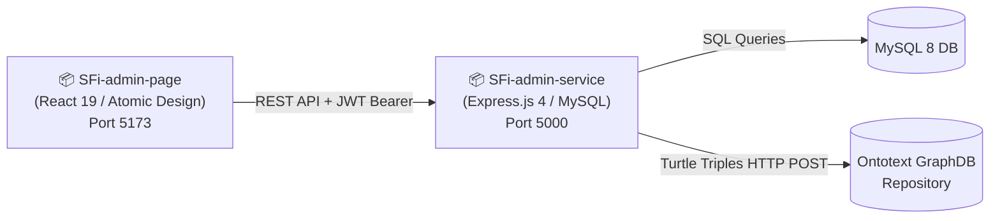

# 🛡️ SFi Admin Dashboard — Operations & Curation Workspace

[](https://react.dev/)
[](https://vitejs.dev/)
[](https://atomicdesign.bradfrost.com/)
[](https://leafletjs.com/)
[](https://graphdb.ontotext.com/)
[](LICENSE)

**SFi-admin-page** is the internal operations CMS and human-in-the-loop data curation dashboard for the **Semantic Flood Inventory System**. It connects operators and administrators to the `SFi-admin-service` REST API, enabling review of scraped flood news articles, spatial coordinate validation on interactive mini-maps, semantic role classification, and on-demand publishing directly into the **Ontotext GraphDB** Knowledge Graph.

---

## 🏛️ System Architecture Context



---

## 🛠️ Technology Stack

* **Core & Framework:** React 19 + Vite 8 (Native ES Modules)
* **Design Philosophy:** **Atomic Design** (`atoms`, `molecules`, `organisms`, `templates`, `pages`)
* **GIS & Spatial Verification:** Leaflet GIS (Thailand Bounding Box Enforcement)
* **Typography:** `Inter` (UI Sans-serif) + `JetBrains Mono` (Monospaced data, coordinates, triples)
* **Auth & Permissions:** Native JWT session management + Role-Based Access Control (RBAC)

---

## 📂 Project Structure

```text
SFi-admin-page/
├── docs/
│   └── AGENT_PROMPT.md         # Comprehensive specification & instructions for AI Agents
│
├── public/                     # Static assets & favicon
├── src/
│   ├── api/
│   │   └── client.js           # REST API client wrapper & auth interceptor
│   ├── context/
│   │   └── AuthContext.jsx     # Auth state, login/logout, and RBAC flags
│   ├── components/
│   │   ├── atoms/              # Button, Input, Select, StatusBadge, RoleBadge, AdminLevelBadge, Modal, Icons
│   │   ├── molecules/          # MetricCard, SearchBar, PaginationControls, UserBadge, GraphDbStatusCard, ArticleMetaHeader, LocationInlineRow, MiniMapPreview
│   │   ├── organisms/          # Sidebar, HeaderBar, ArticlesTable, LocationsReviewTable, MiniMapInspector, ImpactsTable, TimesList
│   │   ├── templates/          # AdminLayout, AuthLayout
│   │   └── pages/              # LoginPage, DashboardPage, StagingQueuePage, ArticleDetailPage
│   ├── App.jsx                 # Application root & view controller
│   ├── main.jsx                # DOM mount entrypoint
│   └── index.css               # Design tokens, table density, and custom animations
│
├── index.html                  # HTML entrypoint & Leaflet CDN
└── package.json                # Project dependencies and build scripts
```

---

## 🌟 Key Features

1. **Dashboard Overview (`/dashboard`):**
   * Real-time pipeline health metrics: Total Articles, Published to KG, Ready for Review, Pending Ingestion.
   * Live Ontotext GraphDB repository connectivity widget with active triple count counter.
2. **Staging Queue (`/staging`):**
   * Filterable, searchable, high-density disaster news article queue.
   * Quick status filter tabs (`All`, `Scraped`, `Processing`, `Validated`, `Published to KG`, `Rejected`).
3. **Human-in-the-Loop Location Curation (`/article/:id`):**
   * Inline editable locations table for correcting coordinates and assigning semantic roles (`FLOOD` vs `EVACUATION`).
   * Interactive Leaflet Mini-Map Inspector with automatic Thailand boundary checks.
   * Read-only quantified disaster impacts (`HumanImpact`, `StructuralImpact`) and temporal entities.
4. **Knowledge Graph Publishing:**
   * One-click *"Publish to Knowledge Graph"* trigger generating RDF Turtle triples pushed to GraphDB.
   * Protected by RBAC (Admin/Superadmin only) and requiring $\ge 1$ approved location.

---

## ⚡ Quick Start

### 1. Installation
```bash
cd SFi-admin-page
npm install
```

### 2. Configure Environment
Create `.env` (or use default `http://localhost:5000/api`):
```env
VITE_ADMIN_API_URL=http://localhost:5000/api
```

### 3. Run Development Server
```bash
npm run dev
# Application will run on http://localhost:5173
```

### 4. Build for Production
```bash
npm run build
```

---

## 📄 License
This project is licensed under the MIT License.
