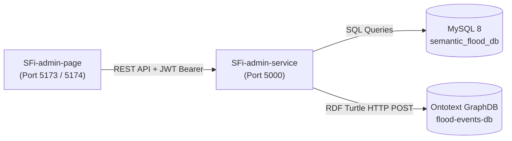

# 🤖 AGENT PROMPT & SPECIFICATION: SFi-admin-page

> **Instruction for AI Agent:** You are the primary frontend engineer for `SFi-admin-page`. Read this document carefully before modifying code, installing packages, or answering questions about this repository.

---

## 1. Project Overview & System Context

`SFi-admin-page` is the **Internal Operations & Data Curation Dashboard** in the **Semantic Flood Inventory System**:

```
[ Semantic Flood Inventory System ]
 ├── 1. Semantic-Flood-Inventory (Python NLP, NER, Geocoding & Ontology Engine)
 ├── 2. SFi-admin-service (REST API, MySQL DB, Ingestion, Staging, Validation, Triplification Trigger)
 ├── 3. SFi-graphql-service (GraphQL Gateway, GraphDB SPARQL Query Engine, Public Read API)
 ├── 4. SFi-frontend (Public Explorer: Leaflet GIS Map, Visual Graph, Public Dashboard)
 └── 5. SFi-admin-page (YOU ARE HERE: Internal Operations CMS, Human-in-the-Loop Curation, GraphDB Publisher)
```

### Purpose of this Application:
1. **Human-in-the-Loop Data Review:** Enable human operators to inspect scraped Thai flood disaster news articles, verify extracted spatial entities, and correct coordinates before ingestion into the Knowledge Graph.
2. **Spatial Geocoding Validation:** Review latitude/longitude coordinates on an interactive Leaflet mini-map with automatic Thailand boundary enforcement ($5.61^\circ \le \text{Lat} \le 20.46^\circ$, $97.34^\circ \le \text{Lng} \le 105.64^\circ$).
3. **Semantic Role Classification:** Verify and adjust spatial role distinctions between inundated hazard zones (`FLOOD`), evacuation shelters/relief centers (`EVACUATION`), and general administrative areas (`GENERAL`).
4. **On-Demand GraphDB Triplification:** Allow authorized administrators to trigger on-the-fly RDF Turtle conversion and publish approved article records directly to the Ontotext GraphDB repository.
5. **Role-Based Access Control (RBAC):** Strictly enforce operator and viewer permissions at the interface level (`SUPERADMIN`, `ADMIN`, `OPERATOR`, `VIEWER`).

---

## 2. Technology Stack & Design System

* **Framework & Core:** React 19 + Vite 8 (`"type": "module"`)
* **Design Philosophy:** **Atomic Design** (Atoms $\rightarrow$ Molecules $\rightarrow$ Organisms $\rightarrow$ Templates $\rightarrow$ Pages).
* **Styling & Aesthetics:**
  * **No AI Slop:** Neutral slate/charcoal foundations, clean monospace data figures, high information density (Linear/Retool/Stripe internal tool aesthetics).
  * **Sidebar (Left):** Dark obsidian workspace (`#090d16` / `#0f172a`) with active indicator tabs and live pulsing GraphDB status badge.
  * **Main Canvas (Right):** Crisp high-contrast light slate canvas (`#f8fafc` / `#ffffff`) with generous whitespace to prevent cognitive fatigue.
* **Geospatial Preview:** Leaflet GIS (`leaflet`) with dynamic pins and boundary validation overlay.
* **Typography:** `Inter` (Sans-serif UI text) + `JetBrains Mono` (Monospaced coordinates, article IDs, and triples counts).
* **State Management:** Native React Context (`AuthContext`) for JWT authentication, session expiration, and RBAC flags.

---

## 3. Communication Endpoints & Backend Contracts

`SFi-admin-page` communicates exclusively with **`SFi-admin-service`** REST API:



### Environment Variables (`.env`):
```env
VITE_ADMIN_API_URL=http://localhost:5000/api
```

### Key API Contracts (`src/api/client.js`):
| Endpoint | Method | Purpose in UI |
| :--- | :---: | :--- |
| `/api/auth/login` | `POST` | Authenticate operator credentials & receive JWT token |
| `/api/auth/me` | `GET` | Retrieve authenticated user profile and RBAC role |
| `/api/pipeline/health` | `GET` | Fetch GraphDB status, triples count, and MySQL article statistics |
| `/api/articles` | `GET` | Fetch paginated disaster articles with search and status filter |
| `/api/articles/:id` | `GET` | Fetch full article details, locations, impacts, and times |
| `/api/articles/locations/:id` | `PATCH` | Save inline coordinate corrections, semantic roles, or approval status |
| `/api/pipeline/publish/:id` | `POST` | Trigger RDF Turtle triplification and publish article to GraphDB |

---

## 4. Atomic Design Architecture

The source code follows a strict Atomic Design hierarchy:

```text
src/
├── api/
│   └── client.js                 # REST client with JWT interceptor & auth:expired event
├── context/
│   └── AuthContext.jsx           # Auth provider with RBAC flags (canEdit, canPublish, isAdmin, etc.)
│
├── components/
│   ├── atoms/                    # Fundamental, indivisible UI building blocks
│   │   ├── Icons.jsx             # Zero-dependency SVG icons (Database, FileText, Pin, Shield, etc.)
│   │   ├── Button.jsx            # Reusable button with variants ('primary', 'publish', 'outline', 'danger')
│   │   ├── Input.jsx             # Text / monospaced input with focus ring tokens
│   │   ├── Select.jsx            # Styled dropdown select
│   │   ├── StatusBadge.jsx       # Status badge (Approved, Validated, Scraped, Rejected)
│   │   ├── RoleBadge.jsx         # Semantic role tag (Flood Hazard, Evac Shelter, General)
│   │   ├── AdminLevelBadge.jsx   # Administrative level pill (Lvl 1 - 6)
│   │   └── Modal.jsx             # Accessible confirmation dialog modal
│   │
│   ├── molecules/                # Simple UI combinations
│   │   ├── MetricCard.jsx        # Data metric card (Stripe / Vercel style)
│   │   ├── SearchBar.jsx         # Search input with keyboard clear & submit actions
│   │   ├── PaginationControls.jsx# Previous/Next page buttons with counter
│   │   ├── UserBadge.jsx         # User identity avatar with role tag
│   │   ├── GraphDbStatusCard.jsx # Live GraphDB connectivity & triple counter widget
│   │   ├── ArticleMetaHeader.jsx # Article title, source URL, date, and coverage badge
│   │   ├── LocationInlineRow.jsx # Single editable location row (lat, lng, role, status, save)
│   │   └── MiniMapPreview.jsx    # Compact Leaflet preview with bounding box check
│   │
│   ├── organisms/                # Complex, distinct UI modules
│   │   ├── Sidebar.jsx           # Dark navigation sidebar with active tab indicators
│   │   ├── HeaderBar.jsx         # Sticky header with breadcrumbs, environment pill, and logout
│   │   ├── ArticlesTable.jsx     # Disaster article queue with filter chips & pagination
│   │   ├── LocationsReviewTable.jsx # Curation table with bulk "Approve All Valid" shortcut
│   │   ├── MiniMapInspector.jsx  # Spatial verification panel with copy coordinates tool
│   │   ├── ImpactsTable.jsx      # Read-only reported disaster impacts table
│   │   └── TimesList.jsx         # Read-only extracted temporal expressions list
│   │
│   ├── templates/                # Page-level structural layouts
│   │   ├── AdminLayout.jsx       # Main application layout (Sidebar + Header + Canvas)
│   │   └── AuthLayout.jsx        # Centered authentication container
│   │
│   └── pages/                    # Complete interactive views
│       ├── LoginPage.jsx         # Operator authentication view
│       ├── DashboardPage.jsx     # Overview metrics & SOP guidelines
│       ├── StagingQueuePage.jsx  # Filterable disaster article queue
│       └── ArticleDetailPage.jsx # Core human-in-the-loop curation & publish view
│
├── App.jsx                       # Root application entrypoint & tab router
├── main.jsx                      # Bootstrap mounting into DOM
└── index.css                     # Design tokens, table density, and animations
```

---

## 5. Key Workflows & Pages

### 1. Authentication (`LoginPage.jsx`)
* Validates credentials against `POST /api/auth/login`.
* Stores the JWT token in `localStorage` (`sfi_admin_token`) for persistent operator sessions.
* Handles expired tokens gracefully via the `auth:expired` custom window event.

### 2. Dashboard Overview (`DashboardPage.jsx`)
* Fetches live metrics from `GET /api/pipeline/health`.
* Displays 4 high-contrast metric cards: Total Articles, Published to KG, Ready for Review, Pending Ingestion.
* Displays real-time Ontotext GraphDB connection status and active triple count.
* Presents standard operating procedures (SOP) for data curation operators.

### 3. Staging Queue (`StagingQueuePage.jsx` & `ArticlesTable.jsx`)
* Loads paginated article lists from `GET /api/articles`.
* Supports quick-filter tab chips (`All`, `Scraped`, `Processing`, `Validated`, `Published`, `Rejected`).
* Supports full-text title search across Thai (`title_th`) and English (`title_en`) titles.
* Row click navigates directly to the curation view for that article.

### 4. Article Detail & Human-in-the-Loop Curation (`ArticleDetailPage.jsx`)
* Loads complete article graph metadata from `GET /api/articles/:id`.
* **Inline Editable Locations:** Operators can edit `lat`, `lng`, `semantic_role` (`FLOOD` / `EVACUATION` / `GENERAL`), and `validation_status` (`PENDING` / `APPROVED` / `MODIFIED` / `REJECTED`) row by row.
* **Single Save & Bulk Approve:** Click the save icon per row (`PATCH /api/articles/locations/:id`) or use *"Approve All Valid"* for fast-track validation.
* **Spatial Mini-Map Inspector:** Renders the focused entity on a Leaflet map, displaying a color-coded pin (Red = Flood, Green = Evacuation) and checking if coordinates are within the Thailand bounding box.
* **Publish to Knowledge Graph:** Triggers `POST /api/pipeline/publish/:id`. Button is enabled ONLY when at least 1 location is `APPROVED` and the user has admin rights. Displays a confirmation modal before execution.

---

## 6. Role-Based Access Control (RBAC) Matrix

| Feature / Action | VIEWER | OPERATOR | ADMIN / SUPERADMIN |
| :--- | :---: | :---: | :---: |
| View Dashboard & Metrics | ✅ | ✅ | ✅ |
| View Staging Queue & Articles | ✅ | ✅ | ✅ |
| Inspect Mini-Map Coordinates | ✅ | ✅ | ✅ |
| Edit Location Coordinates (`lat`/`lng`) | ❌ Disabled | ✅ Enabled | ✅ Enabled |
| Change Semantic Role (`FLOOD`/`EVAC`) | ❌ Disabled | ✅ Enabled | ✅ Enabled |
| Change Validation Status (`APPROVED`, etc.) | ❌ Disabled | ✅ Enabled | ✅ Enabled |
| Publish to Ontotext GraphDB | ❌ Disabled | ❌ Disabled | ✅ Enabled |

---

## 7. How to Run & Build Locally

```bash
# 1. Navigate to admin page workspace
cd D:\Developments\Project\SFi-admin-page

# 2. Install dependencies (if needed)
npm install

# 3. Start development server
npm run dev
# Application will run on http://localhost:5173 (or next available port)

# 4. Production build verification
npm run build
```

---

## 8. Rules & Best Practices for Future AI Agents

1. **Maintain Atomic Design Integrity:** Place new UI elements strictly in their corresponding layer (`atoms/`, `molecules/`, `organisms/`, `templates/`, or `pages/`). Never create circular cross-layer dependencies.
2. **Preserve High Data-Density & Zero AI-Slop:** Avoid oversized cards, decorative gradients, or emoji buttons. Keep UI elements compact, scannable, and clean.
3. **Always Check Bounding Box on Coordinates:** When modifying map components, preserve Thailand bounding box verification ($5.61^\circ \le \text{Lat} \le 20.46^\circ$, $97.34^\circ \le \text{Lng} \le 105.64^\circ$).
4. **Never Bypass RBAC Checks:** Always respect `canEdit` and `canPublish` permissions provided by `useAuth()`.
5. **Keep Monospace Formatting for Data:** Ensure article IDs, geographical coordinates, dates, and triple quantities use `font-mono` / `JetBrains Mono`.
